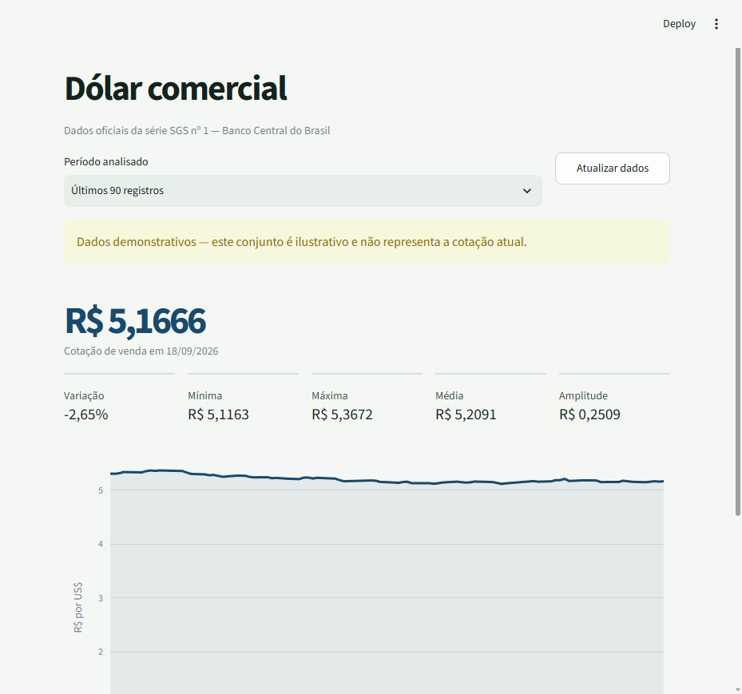
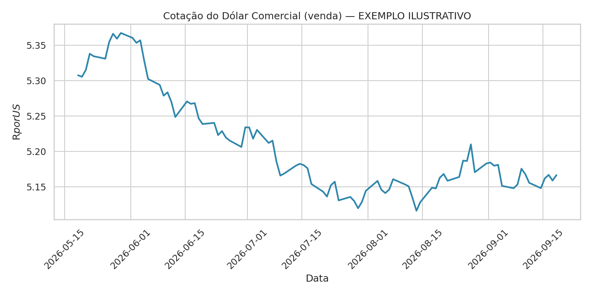

# Cotação do Dólar — Dashboard BCB

[](https://github.com/rhoneycruz-ui/cotacao-dolar-bcb/actions/workflows/tests.yml)
[](https://cotacao-dolar-bcb.streamlit.app/)

Dashboard interativo em Python que consulta a cotação de venda do dólar comercial na API pública do Banco Central do Brasil, apresenta métricas objetivas e permite exportar o período selecionado em CSV.

**[Acessar o dashboard publicado](https://cotacao-dolar-bcb.streamlit.app/)**



> Captura do modo demonstrativo, usado quando a API do Banco Central está temporariamente indisponível.

## O que o projeto entrega

- consulta dos últimos 30, 90, 180 ou 365 registros da série SGS nº 1;
- gráfico interativo com zoom e inspeção por data;
- cotação atual, variação no período, mínima, média e máxima;
- atualização manual sem recarregar a página inteira;
- download dos dados normalizados em CSV;
- fallback demonstrativo explícito quando a API está indisponível;
- validação automatizada em Python 3.10 e 3.12.

## Arquitetura

```text
API BCB ──> src/bcb.py ──> app.py ──> gráfico, métricas e CSV
                  │
                  ├──────> coleta.py ──> data/*.csv
                  └──────> analise.py ──> images/*.png
```

O núcleo compartilhado evita que o dashboard e os scripts históricos interpretem os mesmos dados de formas diferentes:

- `src/bcb.py`: coleta, validação e normalização;
- `src/metrics.py`: cálculos de resumo;
- `src/export.py`: serialização consistente para CSV;
- `app.py`: interface Streamlit e estados de erro/demonstração;
- `tests/`: regressões do núcleo, da interface e dos scripts legados.

## Executar o dashboard

Requer Python 3.10 ou mais recente.

```bash
python -m venv .venv
```

No Windows:

```powershell
.venv\Scripts\python -m pip install -r requirements.txt
.venv\Scripts\python -m streamlit run app.py
```

No Linux ou macOS:

```bash
.venv/bin/python -m pip install -r requirements.txt
.venv/bin/python -m streamlit run app.py
```

O Streamlit informa o endereço local no terminal, normalmente `http://localhost:8501`.

## Testes

Instale as dependências de desenvolvimento e execute a suíte completa:

```bash
python -m pip install -r requirements-dev.txt
python -m pytest -v
```

O GitHub Actions repete essa validação em Python 3.10 e 3.12 a cada push e pull request.

## Scripts de linha de comando

O fluxo original continua disponível:

```bash
python coleta.py
python analise.py
```

- `coleta.py` grava `data/cotacao_dolar_AAAA-MM-DD.csv`;
- `analise.py` lê o CSV mais recente e gera `images/cotacao_dolar.png`.

## Exemplo estático



> A imagem acima e o arquivo [`exemplo_cotacao_dolar.csv`](exemplo_cotacao_dolar.csv) são ilustrativos. Eles demonstram o formato da saída e não representam cotação atual.

## Fonte, integridade e limitações

A fonte consultada é a [API de Dados Abertos do Banco Central do Brasil — série 1](https://dadosabertos.bcb.gov.br/dataset/1-taxa-de-cambio-livre-dolar-americano-venda-diario).

A aplicação rejeita respostas vazias, datas inválidas, campos ausentes e valores não positivos ou não finitos. Quando a consulta falha, nenhum dado demonstrativo é exibido automaticamente: o usuário precisa escolher explicitamente o modo de demonstração.

O projeto depende da disponibilidade da API, não oferece recomendação financeira e não deve ser usado isoladamente para decisões de investimento, câmbio ou contabilidade.

## Tecnologias

Python · Streamlit · Plotly · pandas · requests · pytest · GitHub Actions
